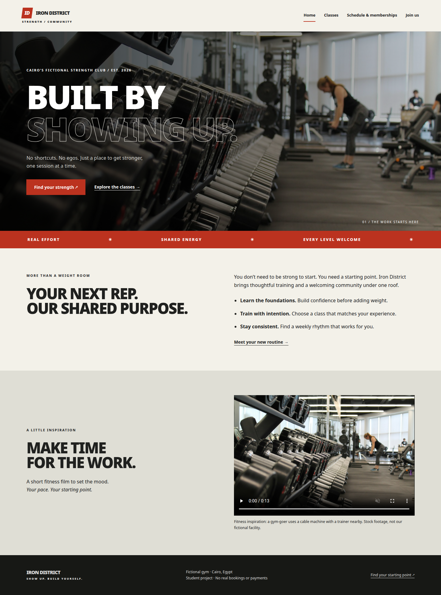
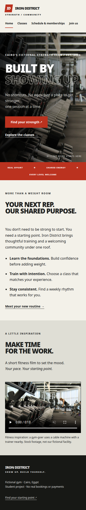
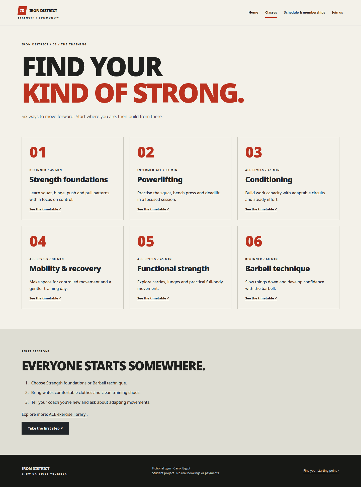
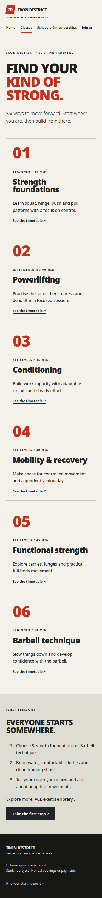
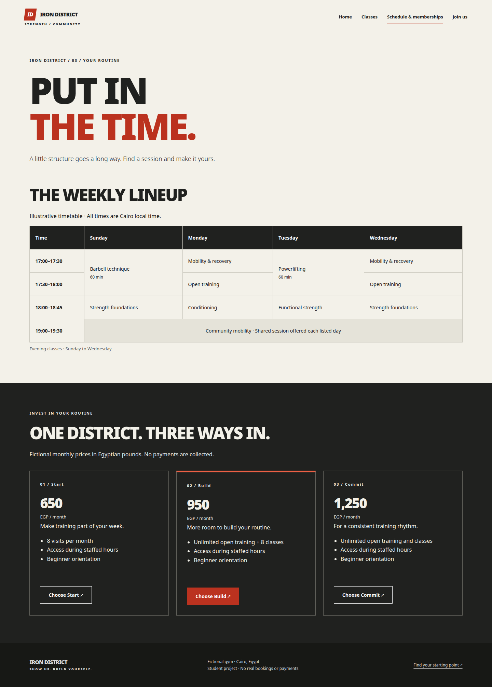
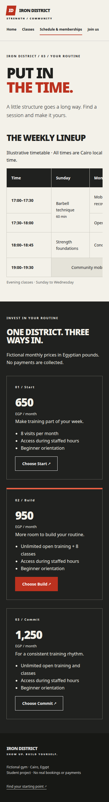
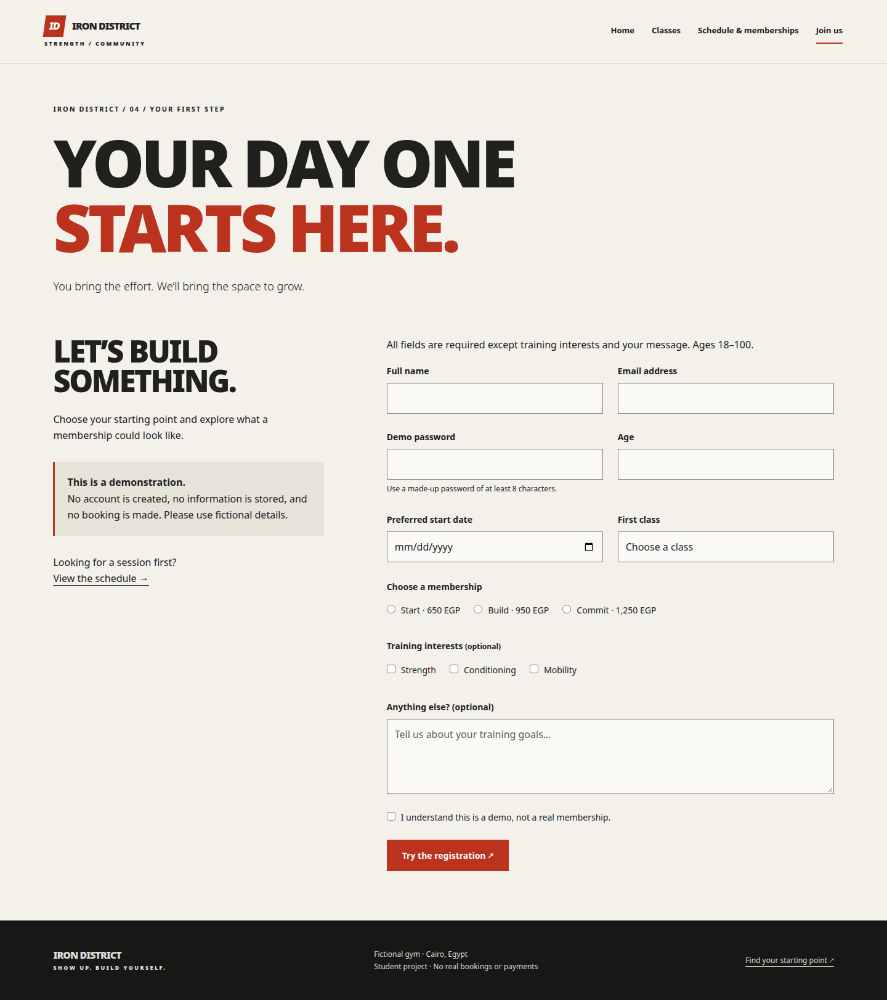
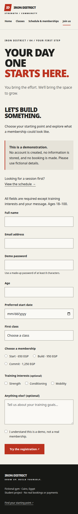

# Iron District - Project Report

**Name:** Mohamed Ahmed Hussein Talaat  
**Student ID:** 224120930

[View the live website](https://mohamedtalaat23.github.io/iron-district/) | [Download the PDF report](report/report.pdf)

## Topic & purpose

Iron District is a fictional Cairo strength gym. This static website helps visitors discover six classes, compare membership prices, view a weekly timetable and try a registration form. It uses HTML5, CSS3 and Bootstrap without a backend or custom JavaScript.

## Running the website

Open `index.html` in a browser. All website media and Bootstrap are local; no installation or server is required. The site is also hosted on GitHub Pages.

## Site map

Shared navigation on every page -> Home (index.html), Classes (classes.html), Schedule & memberships (schedule.html), Join (join.html).
Every page links to all four pages through shared navigation. Home links directly to Classes and Join; class cards link to Schedule; memberships link to Join. The logo returns to Home.

## Requirements checklist

| Requirement | Implementation |
| --- | --- |
| Document structure | All four pages: doctype, lang, charset, viewport, description, unique title; header, nav, main, section and footer. |
| Article and aside | Classes uses article cards and a beginner aside; Join also uses an aside. |
| Text and links | Heading hierarchy and paragraphs throughout; strong and em on Home; shared page links; external ACE link on Classes. |
| Images, lists and video | Home gym image with alt text, benefits unordered list and local MP4 with controls; Classes ordered beginner list. |
| Table and merged cells | Schedule uses caption, scoped headers, rowspan for 60-minute sessions and colspan for shared mobility. |
| Form inputs | Join contains text, email, password, number, date, radio, checkbox, select, textarea and submit; associated labels and fieldsets. |
| Native validation | Required fields, email syntax, 8-character demo password and age 18-100. Radios share a name and empty values; other controls omit names so personal values are never submitted. |
| Custom CSS | assets/style.css: element, class, attribute and descendant selectors; hover, focus-visible and target pseudo-classes; colours, backgrounds, system fonts and box model. |
| Layout | Header/navigation use Flexbox; memberships and split sections use Grid; hero overlays and skip link use positioning; block, flex, grid and none display values. |
| Responsive layout | 767px media query stacks sections and wraps navigation; Bootstrap responsive columns; table scroll region prevents page overflow. |
| Bootstrap bonus | Local Bootstrap 5.3.3 CSS: row/col responsive grid, card, btn and form-control/form-select/form-check-input classes. No JavaScript needed. |

## Form demonstration

The form is a demonstration. Inputs intentionally omit submission names, except membership radios which share a name with empty values for native grouping. No entered personal values are sent. There is no backend, storage, real account, payment or booking.

## Verification

Previous website verification checked all four pages and the former HTML report at widths of 320, 375, 390, 768, 1024 and 1440 pixels without page-wide horizontal overflow. Local links and assets resolve, IDs are unique, and HTML5 parsing reported no errors. Browser checks cover form validation, radio grouping, demo submission, keyboard navigation, timetable scrolling and video playback. Screenshots show the final website at desktop and phone widths.

## Sources & credits

- [Gym photograph: Unsplash asset](https://images.unsplash.com/photo-1534438327276-14e5300c3a48) - stored locally in `assets/images/gym.jpg`.
- [Fitness video: Pexels, video 3209241](https://www.pexels.com/video/3209241/) - stored locally in `assets/video/training.mp4`.
- [Bootstrap 5.3.3](https://getbootstrap.com/) - MIT-licensed stylesheet; copyright notice retained in the local file.

Gym name, programme descriptions, timetable and prices are fictional. Media illustrates the concept rather than a real business.

## Project files

- `index.html`, `classes.html`, `schedule.html`, `join.html`: the four website pages.
- `assets/style.css`: custom styles; `assets/bootstrap/`: Bootstrap stylesheet.
- `assets/images/` and `assets/video/`: local media.
- `report/report.pdf`: printable project report.
- `report/screenshots/`: eight desktop and phone screenshots.

Course lecture files are not included in the submission.

## Page screenshots

Screenshots capture the full page. Desktop viewport: 1440 x 1000. Phone viewport: 390 x 844.

### Home

**Desktop**

**Phone**

### Classes

**Desktop**

**Phone**

### Schedule & memberships

**Desktop**

**Phone**

### Join

**Desktop**

**Phone**

